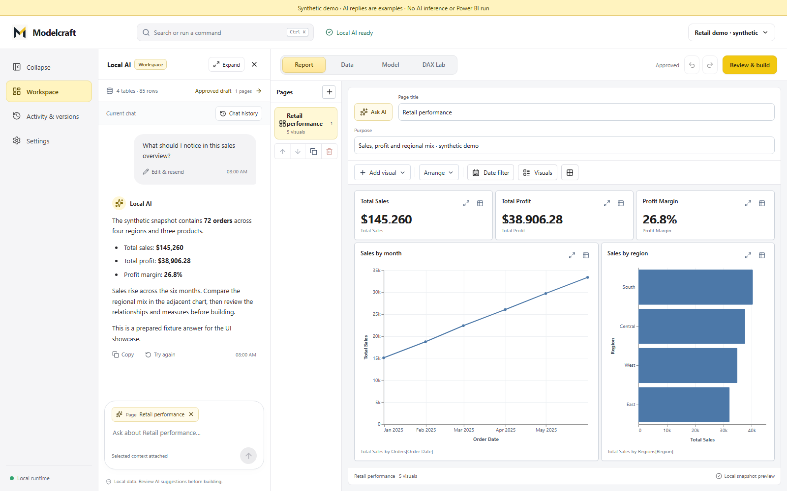
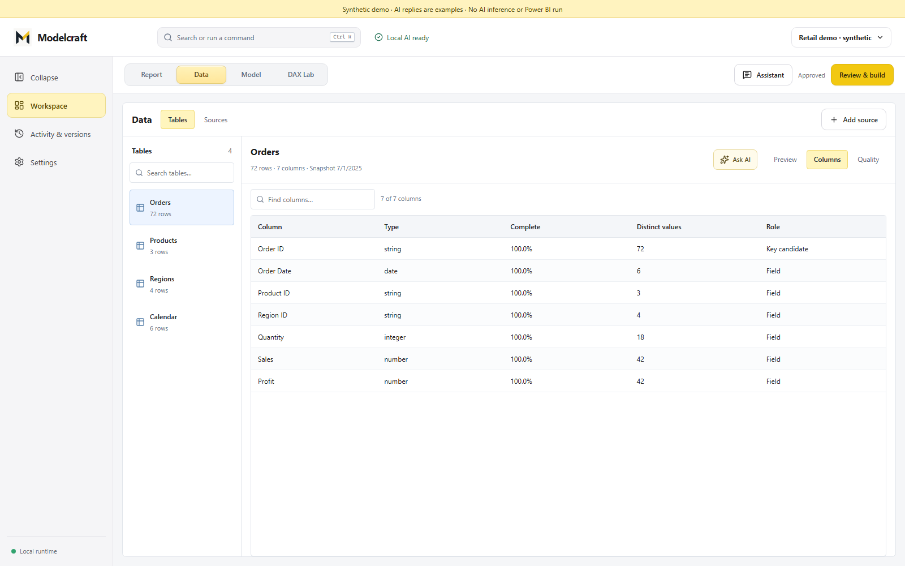
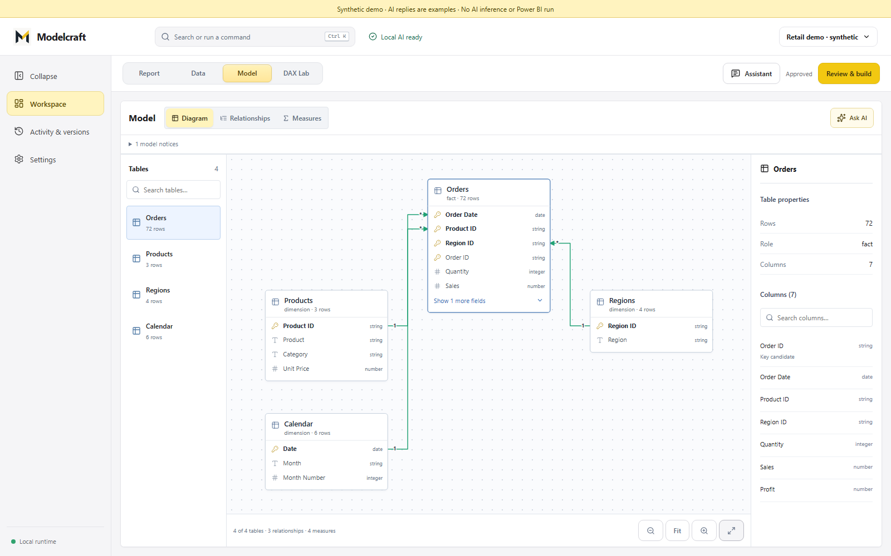
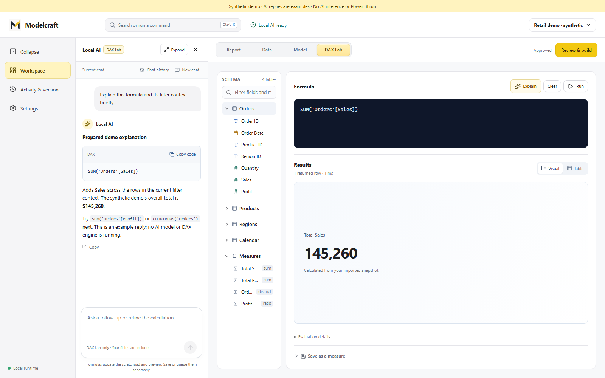

# Modelcraft

**A local AI workspace for Power BI: inspect data, discuss a report, review changes, and export a Power BI project.**

[](LICENSE)
[](https://github.com/ajanovicado/modelcraft/actions/workflows/ci.yml)

Modelcraft brings data profiling, a report canvas, semantic modeling, and DAX assistance into a Windows desktop application. A local model proposes bounded requests; typed contracts and deterministic code handle data access, validation, compilation, and reversible changes.

**[Try the demo](#try-the-demo) · [Architecture](docs/architecture.md) · [Interview walkthrough](docs/interview-walkthrough.md) · [Development setup](docs/development.md)**



*Actual Modelcraft UI with a deterministic synthetic retail fixture. Screenshot chat replies are examples; they are not a benchmark or proof of native Power BI rendering.*

## What it does

- Imports CSV, Excel, and Parquet; preserves source bytes and profiles normalized local snapshots.
- Combines Report, Data, and Model views with contextual assistant conversations.
- Previews source-backed charts and supports reviewed edits, undo, and version history.
- Provides a DAX workspace with formula discussion and validation paths.
- Compiles and validates Power BI Projects (`.pbip`) before promotion or export.
- Runs text-only Qwen3.5 4B locally, with pinned files, cancellation, progress, and idle unloading.

The desktop client uses **Tauri 2, React 19, and TypeScript**. The local API uses **FastAPI, Pydantic, DuckDB, PyArrow, and SQLite**. [See the engineering decisions](docs/architecture.md).

## See the workspace

| Data profiling | Model relationships |
| --- | --- |
|  |  |



All gallery images use synthetic fixtures. [Reproduce the screenshots](docs/demo.md#reproduce-the-gallery).

## Try the demo

The interactive demo runs the real frontend with an in-memory synthetic API. It requires Node.js 22 and npm, and needs no model, Python, Rust, database credentials, or Power BI Desktop.

```powershell
git clone https://github.com/ajanovicado/modelcraft.git
cd modelcraft/apps/desktop
npm ci
npm run demo
```

Open the URL printed by the command. Explore Report, Data, Model, and DAX. Assistant replies are fixed examples; changes exist only for that session. [Follow the three-minute walkthrough](docs/demo.md).

## Run the application from source

The full backend requires Python 3.12 and `uv`; native builds additionally require Rust and Microsoft C++ Build Tools. Local AI needs a verified model/runtime installation. Power BI Desktop is required for native Desktop operations.

```powershell
uv sync --frozen --python 3.12.12 --extra dev --extra desktop
cd apps/desktop
npm ci
```

Use the [development guide](docs/development.md) for authenticated browser development, runtime requirements, and verification commands. Public source exports contain an explicitly unqualified runtime catalog rather than machine-specific model paths or weights.

## Engineering highlights

| Problem | Approach |
| --- | --- |
| Model output can be incomplete or incorrect | Closed request contracts, grounded identifiers, deterministic compilation and validation |
| A retry or stale tab can repeat a change | Idempotency keys, workspace ownership, and optimistic base-hash checks |
| A report write can fail midway | Staging, sealed validation receipts, atomic promotion, and undo |
| Model setup can be interrupted or corrupted | Resumable setup, cached hash verification, and verified replacement before promotion |
| Repeated launches can create competing engines | Native single-instance handling and backend state ownership |
| Preview and Power BI can produce different results | Separate preview, structural validation, native execution, and render qualification |

The [interview walkthrough](docs/interview-walkthrough.md) links these choices to code and gives a demo sequence and discussion prompts.

## Verification

```powershell
$testRoot = Join-Path $env:TEMP ('pt-' + [guid]::NewGuid().ToString('N').Substring(0, 8))
uv run --frozen --extra dev pytest --basetemp $testRoot
uv run --frozen --extra dev ruff check src tests typings
uv run --frozen --extra dev mypy src/ai_powerbi_analyst
cd apps/desktop
npm test
npm run lint
npm run build
npx playwright install chromium
npm run test:chat-browser
npm run test:model-browser
```

CI runs source, dependency, frontend, browser, and native compilation checks. Fixture browser tests do not run a real model or Power BI Desktop. [Testing scope](docs/development.md#verification).

## Current scope and downloads

This is an MIT portfolio project under active development. [Download the source preview](https://github.com/ajanovicado/modelcraft/releases/tag/v0.1.0-portfolio.1) to run the demo or explore the implementation. A signed, clean-machine-qualified Windows installer is a separate milestone.

Supported paths include local-file analysis, reviewed new-project creation, and bounded editing of supported imported reports. Cloud inference, Power BI Service publishing, macros, and unrestricted existing-project migration are excluded. Database connectors and advanced model modes have additional prerequisites and qualification requirements. See [release gates](docs/release-checklist.md) and the [imported-report guide](docs/imported-report-editing-user-guide.md).

## Repository map

```text
apps/desktop/                 React client and Tauri host
src/ai_powerbi_analyst/studio/ Local API, workspaces, conversations and editing
src/ai_powerbi_analyst/powerbi/Project compiler, validation and transactions
vendor/powerbi-rag-runtime/   Owner-authored MIT inference runtime
packaging/powerbi-tools/      Locked toolchain build inputs
scripts/                     Demo, screenshot, verification and release helpers
tests/                       Unit, contract and fixture browser tests
fixtures/                    Synthetic data and scrubbed structural report fixtures
docs/                        Architecture, walkthroughs and release requirements
```

## License and contributions

Application code and the owner-authored runtime are **MIT licensed**. External models, packages, native tools, and reference material retain their own licenses; see [third-party notices](THIRD_PARTY_NOTICES.md) and [runtime provenance](docs/runtime-provenance.md).

Maintained by [ajanovicado](https://github.com/ajanovicado). [Contributing](CONTRIBUTING.md) · [Privacy](PRIVACY.md) · [Security](SECURITY.md).

Power BI is a Microsoft trademark. Modelcraft is not affiliated with or endorsed by Microsoft.
