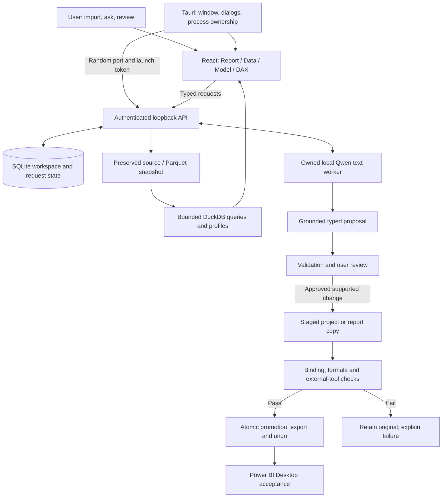

# Modelcraft architecture

The current app combines a Tauri 2 shell, React/TypeScript client and
authenticated FastAPI Python sidecar. The older Streamlit design is preserved
in [legacy-architecture.md](legacy-architecture.md).

## Request and write flow

The synthetic demo replaces the API with an in-memory fixture and uses fixed
assistant examples; it does not run the native pipeline in this diagram.

## Responsibilities

| Component | Responsibility | Code |
| --- | --- | --- |
| Tauri | Single window, native dialogs, token/port and sidecar lifetime | [`lib.rs`](../apps/desktop/src-tauri/src/lib.rs) |
| React | Workspace, selected context, conversations and setup | [`App.tsx`](../apps/desktop/src/App.tsx) |
| API/service | Authentication, validation and capability routing | [`api.py`](../src/ai_powerbi_analyst/studio/api.py), [`service.py`](../src/ai_powerbi_analyst/studio/service.py) |
| Data engine | Signatures, snapshots, profiles and bounded queries | [`ingestion.py`](../src/ai_powerbi_analyst/studio/ingestion.py), [`aggregates.py`](../src/ai_powerbi_analyst/studio/aggregates.py) |
| Inference | Pinned files, text generation, cancellation and unload | [`text_only_backend.py`](../src/ai_powerbi_analyst/llm/text_only_backend.py) |
| State | Durable objects, idempotency and optimistic changes | [`state.py`](../src/ai_powerbi_analyst/studio/state.py) |
| Report engine | Typed edits, validation, versions and delivery | [`report_edits.py`](../src/ai_powerbi_analyst/studio/report_edits.py), [`validation.py`](../src/ai_powerbi_analyst/powerbi/validation.py) |

## Boundaries and tradeoffs

The model has no shell or unrestricted filesystem interface. It proposes
bounded plans and discussion text. Closed contracts and grounded identifiers
constrain executable requests; deterministic code owns queries, compilation,
validation and mutation. Programming examples are displayed rather than run.

The API requires a random bearer token and binds to loopback. Production uses
its native handshake, while browser development origins are explicit. Selected
database connections are user-configured data access; local inference does not
upload prompts or source snapshots.

Report changes are staged. Base-hash checks, operation ownership and idempotency
guard against stale/repeated changes. Supported save and promotion boundaries
preserve originals and record undo/recovery receipts. Failure-path tests, rather
than this diagram, establish these invariants.

| Choice | Benefit | Cost / limit |
| --- | --- | --- |
| Native shell plus Python engine | Desktop integration and a mature data ecosystem | Explicit child lifecycle and packaging |
| CPU-only local model | Local inference with a fixed identity | Large model download and cold-start latency |
| Typed plans and deterministic execution | Bounded, inspectable operations | Each supported capability must be implemented |
| Logical previews | Fast iteration before Desktop | Appearance and numerical results need native reconciliation |
| Staging and receipts | Reversible writes and provenance | More storage and state-machine complexity |

## Verification levels

Unit/contract tests use synthetic data. Fixture browser tests exercise real UI
with mocked APIs. Live-model evaluation measures schema and semantic success.
Power BI checks cover numerical behavior and rendering. Installed-app checks
cover signing, setup, restart, upgrade and recovery. These levels have separate
[release gates](release-checklist.md).
