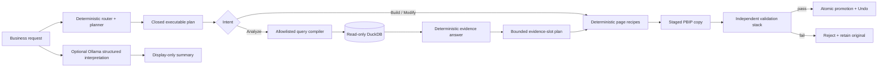

# Architecture and Trust Boundaries

## System rule

The local model is a display-only interpreter, not an operator. It may summarize
the deterministic route/plan through a schema-constrained response, but its
output cannot add, remove, or alter executable fields. All numerical and report
behavior is selected and executed by deterministic code against closed
contracts.

## Runtime components

### Client application

Streamlit renders business-facing plans, compact grounded evidence, progress,
trust status, Apply, Undo, and Desktop reveal. Active work lives in a SQLite
job/event journal rather than browser session state. Idempotency keys and
operation ownership are designed to block refresh-driven duplicate writes;
current-revision and target-Windows refresh/recovery results must still be
recorded as release evidence rather than inferred from the design.

### Semantic catalog

The catalog is the sole vocabulary for metrics and dimensions. Each metric
records its stable ID, Power BI reference, approved SQL expression, aliases,
format, description, dimensions, and dependencies. Unknown or ambiguous names
clarify or fail; they are never guessed.

### Local analyst

DuckDB opens the internal database read-only. External access, unsigned
extensions, extension install/autoload, and model-authored SQL are disabled.
An `AnalysisPlan` selects one of eight query families. A compiler produces one
parameterized SELECT from fixed templates, runs it in a bounded worker, and
returns no more than 200 rows.

### Power BI composer

An adapter compiles recipe IDs into pinned pbi-cli operations or a deterministic
mock backend. It writes only to a staged report copy. After external tools
return, it reruns local structure, binding, and postcondition checks, then seals
the complete stage manifest, changed-file allowlist, project hash, and report
hash. Promotion rechecks that seal under the shared project lock immediately
before the swap. Undo restores the content-addressed last-known-good snapshot.
A process restart can recover only one valid pending swap whose displaced
report is anchored to the attested baseline/journal chain; normal full
verification runs immediately after recovery.

The `executive_light` presentation preset is also closed: one content-hashed
theme file is registered into PBIR, each approved visual receives a fixed title,
border, and background, and postcondition validation checks the theme resource,
hash, container properties, layout, visual kind, binding role, semantic kind,
and reference. Client-facing polish cannot drift independently of safety.

### Prepared analytics

Forecasts, approved price scenarios, and driver tables are prepared before the
session, versioned, hashed, and available to both the analyst and Power BI
model. Every answer rechecks the manifest, database, catalog, and all six
governed Parquet sources both before and after execution. Scenario output is
always labelled mechanical, not predictive. Exact
formulas, residual treatment, model-selection gates, and interval provenance
are documented in the [driver bridge](methods/driver-bridge.md),
[forecast](methods/forecast.md), and
[price-scenario](methods/price-scenario.md) methods.

## Public contracts

- `ProjectBundle`: compatible PBIP, report, semantic model, DuckDB, hashes,
  versions, cutoff, and capabilities.
- `RouteDecision`: closed intent and selected catalog objects.
- `AnalysisPlan`: approved operation, metric/dimension IDs, time window,
  filters, ranking, and scenario value.
- `ReportChangePlan`: fixed page/visual recipes, semantic IDs, assumptions,
  base hash, and style.
- `EvidenceAnswer`: conclusion, exact facts, rows/chart, filters, cutoff and
  data/catalog/query provenance.

## Threat model and controls

| Risk | Control |
|---|---|
| Prompt or report metadata attempts execution | Treat text as data; closed schemas; no model-controlled executable fields |
| SQL injection | Fixed templates, allowlisted identifiers, parameterized values, one-SELECT inspection |
| Path traversal | Resolved project roots, safe relative paths, explicit changed-file allowlist |
| Partial report mutation | Stage, validate, atomic promote, journal, last-known-good snapshot |
| Validator or concurrent stage mutation | Post-tool local revalidation plus full-stage content seal rechecked under the promotion lock |
| Concurrent writer | Shared operation lock, base-report hash recheck, and write guard immediately before promotion/Undo/recovery |
| Interrupted directory swap | One strict pending intent, baseline-anchored displaced hash, trusted locked startup recovery, then full verification |
| Stale or mismatched data | Pre/post hashes for manifest, DuckDB, catalog, and all six prepared sidecars fail closed |
| Streamlit rerun duplicates writes | Durable idempotency keys in SQLite journal |
| Desktop corrupts an open project | Power BI Desktop process check blocks writes |
| False validation claim | Separate locally validated and Desktop render-verified states |
| Theme or presentation drift | Frozen theme hash plus exact visual-container postconditions |
| Local model consumes reveal memory | `keep_alive=0`, verify `ollama ps`, stop fallback before Desktop launch |
| Scripted flow accidentally contacts Ollama | No model client is constructed; reveal uses a model-already-unloaded path with zero HTTP/CLI calls |

## Deployment boundary

The first release is a single-user, local Windows demo against one prepared,
thick PBIP project. It does not author the semantic model, accept arbitrary
data, publish to Power BI Service, use cloud inference, or expose arbitrary
report operations.
